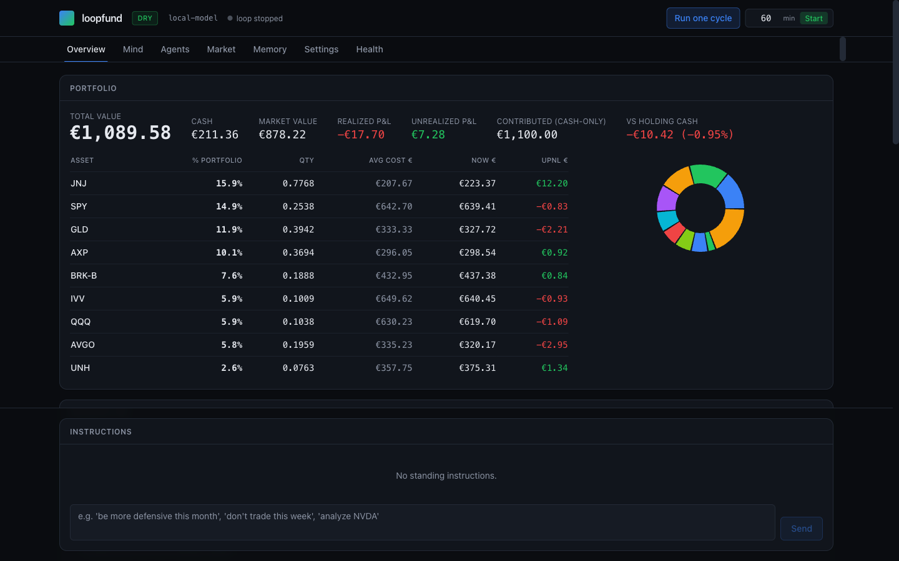
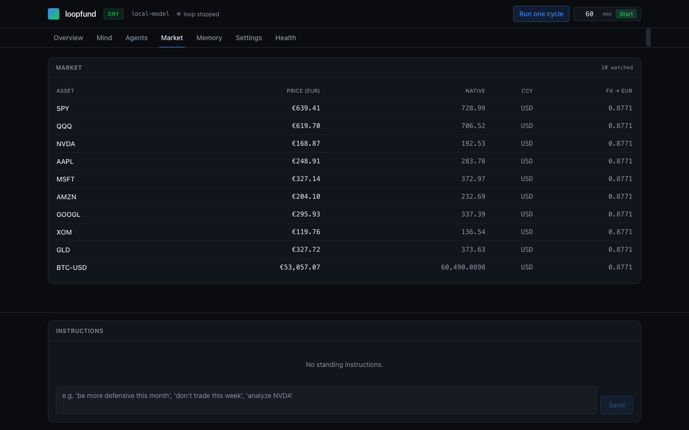
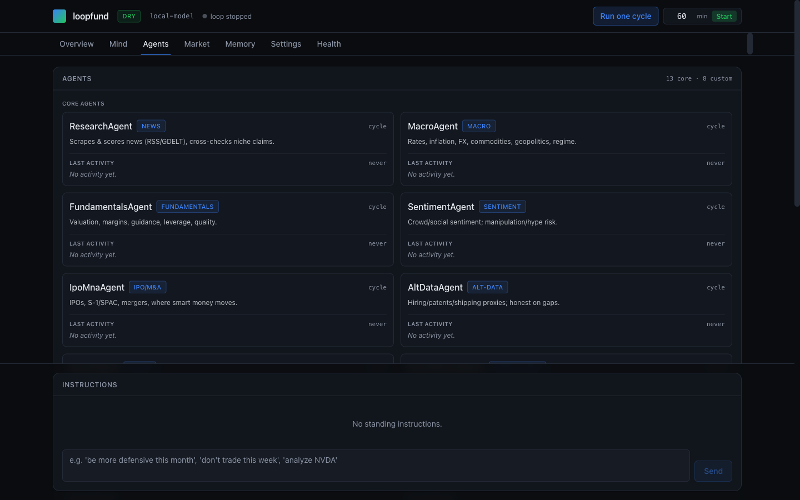

# loopfund

[](https://github.com/jaknak13-source/loopfund/actions/workflows/ci.yml)
[](LICENSE)


loopfund is a local first, always on multi agent investment research and
portfolio-management sandbox. It runs a continuous research loop in which
specialist agents study a watchlist using free market data, then a coordinator
agent makes one allocation decision per interval against a simulated EUR ledger.

It runs in dry mode: a simulated ledger that uses real market prices, real
trading fees, and real FX rates, but places no real orders. Live execution is
intentionally gated and unimplemented.



## Disclaimer

Read this before anything else.

- loopfund is for research and education only. It is not financial advice, not
  an investment recommendation, and not a solicitation to buy or sell anything.
- It runs in dry mode only. It simulates a portfolio. It does not place real
  trades and cannot move real money.
- It makes no guarantee of returns. Simulated results are not real results and
  do not predict real results.
- Outputs come from language models and free data feeds that can be wrong,
  stale, or incomplete.
- You use it at your own risk. Nothing here is produced by, or constitutes, a
  licensed financial professional.

## Features

- A continuous research loop that runs specialist agents on a configurable
  schedule, with one model call at a time to stay light on memory.
- Core agents for research, macro, fundamentals, sentiment, IPO/M&A, alternative
  data, quant, and risk, plus a decision coordinator.
- Agent findings are combined by evidence-weighted aggregation, not majority vote.
- A risk agent that can veto or haircut a proposed action.
- `NO_ACTION` is a valid outcome of any cycle.
- Optional dynamic agents defined as plain markdown briefings, with no code.
- A simulated EUR ledger with real prices, fees, and FX.
- A learning store that scores matured predictions and tracks an S&P 500 (SPY)
  benchmark.
- House rules in `docs/STRATEGY.md` that are enforced in code.
- One model adapter layer covering local and cloud OpenAI-compatible backends
  plus native Anthropic and Gemini.
- A tabbed web dashboard you can reconfigure live without a restart.
- A command-line interface for one-off cycles, status, backtests, and backups.
- An optional Model Context Protocol (MCP) server that exposes the fund as tools.
- Free data sources by default. Optional keys unlock extra sources.

## Quickstart

You need Python 3.11 or newer. Node 18+ is optional (see [Development](#development)).

One command does everything: it installs dependencies on first run, then starts
the dashboard.

### macOS / Linux

```bash
./start.sh
```

If you downloaded a ZIP instead of cloning, the file may not be executable, so
use `bash start.sh` instead.

### Windows

Double-click `start.bat`, or from a command prompt:

```bat
start.bat
```

On first run this creates a virtual environment and installs dependencies, then
boots the backend, waits until it is healthy, opens the dashboard in your default
browser, and prints the URL in the terminal. The default URL is
`http://127.0.0.1:8500`. Stop with `Ctrl+C`. Later runs skip the install and start
immediately.

## Choosing a model

By default loopfund runs fully local with no API keys.

1. Install [LM Studio](https://lmstudio.ai) or [Ollama](https://ollama.com).
2. Load (LM Studio) or pull (Ollama) any instruct/chat model.
3. Put that model's id in the dashboard Settings tab, or in `config/models.yaml`
   (the `model:` field).

To use a cloud backend instead, set `backend:` in `config/models.yaml` and paste
that backend's API key in the dashboard, or put it in `.env`.

### Supported backends

Backends are selected by name with `backend:` in `config/models.yaml`. Each
backend's URL and key come from `.env` (see `.env.example`) or the Settings tab.

| Type | Backend name | Default endpoint | Key needed |
|---|---|---|---|
| Local | `local` (LM Studio, default) | `http://localhost:1234/v1` | no |
| Local | `ollama` | `http://localhost:11434/v1` | no |
| Local | `vllm` / LocalAI | `http://localhost:8000/v1` | no |
| Cloud | `openai` | provider default | yes |
| Cloud | `anthropic` | provider default | yes |
| Cloud | `gemini` | provider default | yes |
| Cloud | `openrouter` | provider default | yes |
| Cloud | `groq` | provider default | yes |
| Cloud | `together` | provider default | yes |
| Cloud | `deepseek` | provider default | yes |
| Cloud | `mistral` | provider default | yes |
| Cloud | `xai` | provider default | yes |
| Cloud | `qwen` (Alibaba DashScope) | provider default | yes |

Any other OpenAI-compatible host works too: point one preset's `*_BASE_URL` at it.

Each backend reads its credentials from env vars following the pattern
`<NAME>_API_KEY` and `<NAME>_BASE_URL`, for example `OPENAI_API_KEY`,
`ANTHROPIC_API_KEY`, `GEMINI_API_KEY` (or `GOOGLE_API_KEY`),
`OPENROUTER_API_KEY`, `GROQ_API_KEY`, `DEEPSEEK_API_KEY`, and `DASHSCOPE_API_KEY`
for `qwen`. Local backends need no key.

## Configuration

There are three places to configure loopfund, and they overlap by design.

- `.env` holds secrets and endpoints. Copy `.env.example` to `.env` and fill in
  only what you need. Everything is optional, and with no keys at all loopfund
  runs fully local. Never commit `.env` (it is git-ignored).
- `config/models.yaml` sets which backend and model each profile and agent uses,
  plus temperature and token limits.
- The dashboard Settings tab edits any setting live, including raw JSON. You can
  switch backend and model without a restart. API keys pasted here are stored
  server-side in `.env`, stay git-ignored, and are never displayed back.

Other config files:

- `config/settings.yaml` sets mode, base currency, watchlist, loop intervals,
  decision rules, portfolio sizing, and logging.
- `config/risk_limits.yaml` sets the risk governor limits.

### Data sources

Free sources work with no keys:

- yfinance for prices.
- frankfurter.dev and er-api for FX.
- GDELT and RSS for news.
- SEC EDGAR for filings and XBRL.

Optional keys (FRED, Reddit, NewsAPI) enable extra sources. Leaving a key blank
disables only that source.

## Using the dashboard

The dashboard is a tabbed web UI:

- Overview: portfolio value, positions, and recent decisions.
- Agents: each specialist agent's stance, findings, and confidence.
- Market: watchlist and market data.
- Memory / Mind: long-term memory and the live thinking feed.
- Settings: every setting, editable live, including raw JSON and backend, model,
  and key changes without a restart.
- Health: service health.

The Market tab shows live prices in both native currency and your base currency:



## How it works

A continuous research loop runs specialist agents on a schedule.

Core agents are Research, Macro, Fundamentals, Sentiment, IPO/M&A, AltData,
Quant, Risk (a skeptic with veto power), and a Decision coordinator. Optional
dynamic agents are defined as markdown briefings in `agents/briefings/*.md`, so
you add or change one by editing a markdown file.



Findings are combined by evidence-weighted aggregation, not a majority vote. The
Risk agent can veto or haircut a proposed action. The Decision agent makes one
allocation decision per configured interval, and `NO_ACTION` is a valid decision.

A learning store scores predictions once they mature and tracks an S&P 500 (SPY)
benchmark. House rules live in `docs/STRATEGY.md` and are enforced in code. Inference
is serialized to one model call at a time to keep memory use low.

## CLI reference

Pass any command to the launcher (`./start.sh <cmd>`, or `start.bat <cmd>` on
Windows):

| Command | What it does |
|---|---|
| `serve` | Launch the dashboard (backend and loop control). |
| `cycle` | Run one full research/decision cycle now. |
| `status` | Print the current portfolio snapshot. |
| `backtest TICKER` | Quick backtest of one ticker. |
| `backup` | Snapshot runtime state now. |
| `backups` | List backups. |
| `restore <name>` | Restore a backup (snapshots current state first). |
| `reset` | Wipe runtime state (after a safety backup). |

## Project layout

```
agents/          specialist agents and markdown briefings
core/            config, store, loop runner, app wiring, backups, sandbox
models_adapter/  model backends and the backend router
quant/           factors, valuation/DCF, backtest, regime detection
tools/           data sources and plugins
memory/          vector RAG and the learning store
execution/       dry-mode ledger and risk governor
schemas/         pydantic models
dashboard/       FastAPI API backend and React/Vite web frontend
mcp_server/      Model Context Protocol server
config/          settings.yaml, models.yaml, risk_limits.yaml
skills/          markdown playbooks
scripts/         CLI entrypoint (run.py), requirements.txt, helper scripts
tests/           unit tests
deploy/          Docker assets (Dockerfile, compose, nginx)
docs/            STRATEGY, ROADMAP, EXTENDING, screenshots
```

## Development

A prebuilt dashboard ships in the repo, so it works without Node. `start.sh`
rebuilds it on first run if Node 18+ is present, or rebuild it yourself:

```bash
cd dashboard/web && npm install && npm run build
```

For live frontend development on macOS/Linux:

```bash
./start.sh --dev
```

This runs the backend plus the Vite dev server on `http://localhost:5173`, which
proxies `/api` to port `8500`. In production the backend serves the built
dashboard and the API on a single port.

Run the tests:

```bash
.venv/bin/python -m pytest
```

There are 218 unit tests.

Lint with ruff (line length 100):

```bash
.venv/bin/ruff check .
```

## MCP server

`mcp_server/` exposes the fund as Model Context Protocol tools under the server
name `loopfund_mcp`, over stdio or streamable-HTTP. Any MCP client can read the
portfolio, agent analyses, and decisions, search memory, and trigger a cycle.
See `mcp_server/README.md` for details.

## Safety and limitations

- Dry mode only. Live trading is gated in `core/app.py`: it requires both
  `mode=live` and the environment variable `LOOPFUND_ALLOW_LIVE=1`, and the
  execution adapter is intentionally unimplemented, so it cannot move real money.
- Model-authored code execution fails closed without an OS sandbox.
- Prompt-injection defenses fence untrusted web, news, and memory content.
- Free data feeds can be wrong, delayed, or unavailable.
- Language model outputs can be wrong. Treat every result as a hypothesis, not a
  recommendation.

### Running it safely

- It binds to `127.0.0.1` (localhost) by default, so only your machine can reach
  it. That is the intended way to run it.
- The dashboard API has no authentication and can write files, change settings,
  and (if you enable it) run model-authored code. Do not expose it to other
  machines or the internet without putting authentication in front of it. If you
  set `LOOPFUND_HOST=0.0.0.0` or deploy with Docker, read
  [deploy/DEPLOY.md](deploy/DEPLOY.md) first and add a password (the bundled
  `deploy/nginx.conf` shows how).
- Code execution by the research agent is off by default
  (`agents.allow_code_execution: false`). Turn it on only on a machine whose
  files you would be comfortable handing to the model.
- Your API keys live in `.env`, which is git-ignored. Never commit it.
- Report a vulnerability per [SECURITY.md](.github/SECURITY.md).

## Contributing

See [CONTRIBUTING.md](.github/CONTRIBUTING.md).

## License

Apache-2.0. See [LICENSE](LICENSE).
